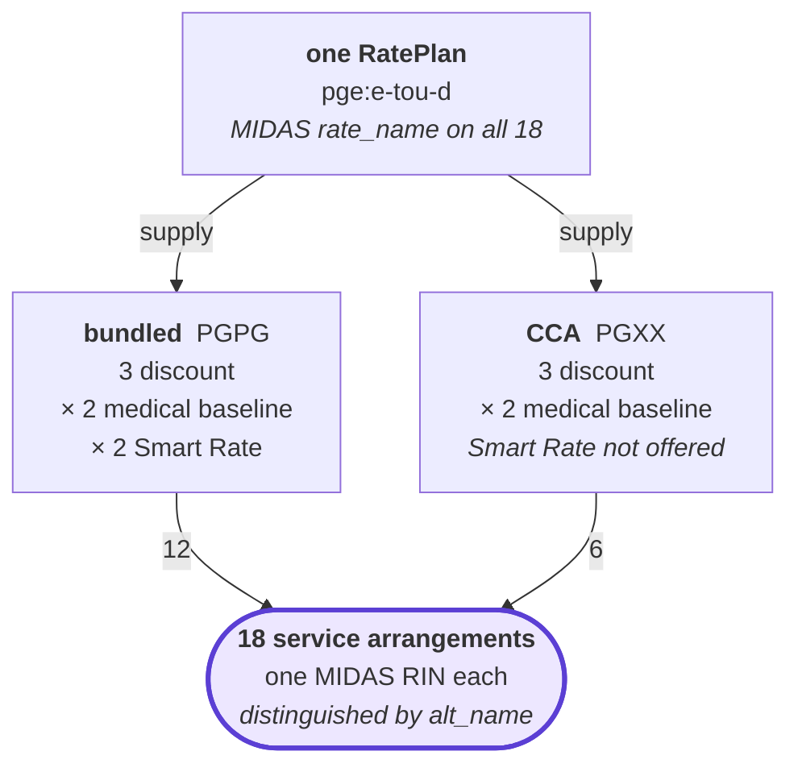

<!-- SPDX-FileCopyrightText: 2026 Clark Communications Corporation -->
<!-- SPDX-License-Identifier: CDLA-Permissive-2.0 -->

# What a MIDAS RIN identifies

California's Market Informed Demand Automation Server publishes electricity prices keyed by a Rate Identification Number. A RIN is widely treated as naming a tariff. It does not. It names a **service arrangement**: a base rate plan composed with the particular overlays and supply arrangement a customer actually has.

That distinction decides where a RIN can be recorded in a URPX document, and getting it wrong produces assertions that validate cleanly and are false. This note sets out the evidence, because the point is not obvious.

Figures below come from two reads of the state's feed. The older is a 2026-05-30 snapshot of 5,207 identifiers cached at `reports/midas-coverage.json`, which covers the six investor-owned-utility party segments and not California: the live feed carries **74,097 identifiers over 33 party segments**, most of them community choice aggregators. The newer is that live read, mined into `data/midas/` (see LAYOUT.md 10b). **Neither is this corpus.** This corpus cites 24 identifiers, all in three net-billing filings and all as free text rather than as identifiers, for the reasons set out below.

## A rate plan has many RINs

PG&E's E-TOU-D is one rate plan. MIDAS publishes eighteen RINs for it:

```
USCA-PGPG-0200-0000  E-TOU-D                                   USCA-PGXX-0200-0000  E-TOU-D-CCA
USCA-PGPG-0201-0000  E-TOU-D-Smart Rate                        USCA-PGXX-0202-0000  E-TOU-D-CCA-CARE
USCA-PGPG-0202-0000  E-TOU-D-CARE                              USCA-PGXX-0203-0000  E-TOU-D-CCA-FERA
USCA-PGPG-0203-0000  E-TOU-D-FERA                              USCA-PGXX-0204-0000  E-TOU-D-CCA-Medical Baseline
USCA-PGPG-0204-0000  E-TOU-D-Medical Baseline                  USCA-PGXX-0210-0000  E-TOU-D-CCA-Medical Baseline-CARE
USCA-PGPG-0205-0000  E-TOU-D-Smart Rate-Medical Baseline       USCA-PGXX-0211-0000  E-TOU-D-CCA-Medical Baseline-FERA
USCA-PGPG-0206-0000  E-TOU-D-Smart Rate-CARE
USCA-PGPG-0207-0000  E-TOU-D-Smart Rate-FERA
USCA-PGPG-0208-0000  E-TOU-D-Smart Rate-CARE-Medical Baseline
USCA-PGPG-0209-0000  E-TOU-D-Smart Rate-FERA-Medical Baseline
USCA-PGPG-0210-0000  E-TOU-D-Medical Baseline-CARE
USCA-PGPG-0211-0000  E-TOU-D-Medical Baseline-FERA
```



They vary along four facts about the customer: supply arrangement, discount program (none, CARE or FERA), medical baseline status, and Smart Rate enrollment. Not every combination is offered, which is why there are eighteen rather than twenty-four: Smart Rate appears on the bundled path only. Overlays stack up to three deep. CARE and FERA never co-occur, which is correct: the programs are mutually exclusive.

MIDAS itself keeps the two levels apart, which is the whole point. `rate_name` is "E-TOU-D" on all eighteen records; `alt_name` is what distinguishes them.

A regulator identifying the plan would have issued one RIN. Eighteen exist because the published price differs by customer, and the RIN names the customer's arrangement.

## The four-character segment encodes the parties, not a price component

`USCA-PGXX-0200-0000` decomposes as country/state, a four-character party segment, a rate identifier, and a sub-identifier.

The party segment is two two-character codes. Measured across all 5,207 records:

- **The first pair is the distribution utility, or `XX` where none is named.** In the six investor-owned segments it matched the utility on every record, 0 exceptions, which read as a rule and was a property of that sample. Across the live feed, 13 of 30 real segments begin with `XX`, and the `Distribution` lookup table gives `XX` as "Unspecified". The two largest segments in California are `XXSA` and `XXSJ`, generation-only identifiers with no distribution utility named.
- **The second pair is the energy supplier.** Where it repeats the utility (`PGPG`, `SCSC`, `SDSD`) the utility supplies both delivery and generation: a bundled customer. Where it is `XX` the customer's generation comes from elsewhere, so the rate covers delivery only.

The evidence for the second half is asymmetric and worth stating precisely. Of 3,466 records whose second pair names the utility, **zero** carry CCA or Direct Access in their name. Of 1,741 records whose second pair is `XX`, 99 say CCA or DA explicitly and the rest carry no name at all. So `XX` is necessary for non-utility supply; the name field simply often does not say.

Six segments occur in the older snapshot, `PGPG`, `PGXX`, `SCSC`, `SCXX`, `SDSD`, `SDXX`, none beginning with `XX`. That was a property of the sample, and the live feed settles it: `XX`-first codes are not merely coherent under the grammar but the common case. The `Distribution` and `Energy` lookup tables decode both halves to a named utility with a URL, so `XXSA` reads as unspecified distribution with San Diego Community Power as the supplier, and `PGVC` as PG&E distribution with Valley Clean Energy supply.

## Why this forbids recording a RIN as a plan or modifier identifier

URPX v0.5.1 admits `urpx:hasIdentifier` on `RatePlan`, `RatePlanVersion`, `RatePlanModifier`, `RatePlanModifierVersion` and `OrganizationIdentity`. None of those is a composition. `urpx:RatePlan` is the plan identity, whose `skos:note` reads "The stable identifier. No pricing content"; `urpx:RatePlanVersion` is that identity's snapshot for a window.

So attaching `USCA-PGPG-0202-0000` to `pge:e-tou-d` would assert that the unmodified plan is identified by a code that identifies the plan plus CARE. Attaching it to the CARE modifier would assert that CARE alone is identified by a code that also names E-TOU-D. Both validate: `RatePlanIdentifierShape` and `RatePlanModifierIdentifierShape` are `sh:closed` over exactly `skos:notation`, `urpx:scheme` and `urpx:identifierJurisdiction`, so there is no slot in which to record what the identifier is scoped to.

This corpus therefore records RINs beside arrangements rather than inside filings, in `reports/rate-identifiers.{md,edn}`, keyed by the arrangement's intrinsic identity: base version IRI, sorted modifier version IRIs, sorted alternative selections.

## A RIN is an attestation, not an identity

An arrangement exists whether or not a RIN can be found for it. Deriving which tariff documents and features compose to produce the prices a given RIN covers is straightforward in some cases and intractable in others, and MIDAS itself is incomplete. A RIN is therefore recorded with its provenance: corroborated against the published feed, derived but uncorroborated, or unresolved. The third is a legitimate resting state.

Ten of the twenty-four identifiers this corpus cites rest in that third state, and it is worth saying why so that nobody removes them. They are SDG&E's net-billing `NB##` family, five on each of the `XXSD` and `SDXX` sides. Neither appears in either read, and the absence falls on the **rate code** rather than the party segment. In the older snapshot 5,204 of 5,207 rate codes were numeric, which made `NB##` look exotic; across the live feed 43,126 of 74,097 are non-numeric, so the shape is ordinary. Thirty-two live identifiers carry an `NB`-prefixed code, across five other utilities. What is absent is specifically SDG&E's, on both the `SDXX` and `XXSD` sides, each of which is otherwise well populated. Nor were the strings composed here. `scripts/extract-sdge-nbt-eec-values.py` reads them out of the `RIN` column of SDG&E's own MIDAS-format upload archives. So they are uncorroborated rather than malformed, and the disposition is to re-derive from a refreshed feed rather than to delete. A candidate to check then is `USCA-SDXX-0092-0000`, whose `alt_name` is "EVTOU5NM NBT LY 2023", where "LY" matches the lock-year naming in those archives. The 401 that blocked this was a v1.0 artifact rather than a credential problem: MIDAS v2.0 went live 2026-06-22 and withdrew v1.0 the same day, and every v2.0 GET is public.

Where a RIN is attached it asserts that our composition is the same thing the state means by that code. That claim is falsifiable and will occasionally be wrong, so what is recorded is how the correspondence was established, not only the value.
