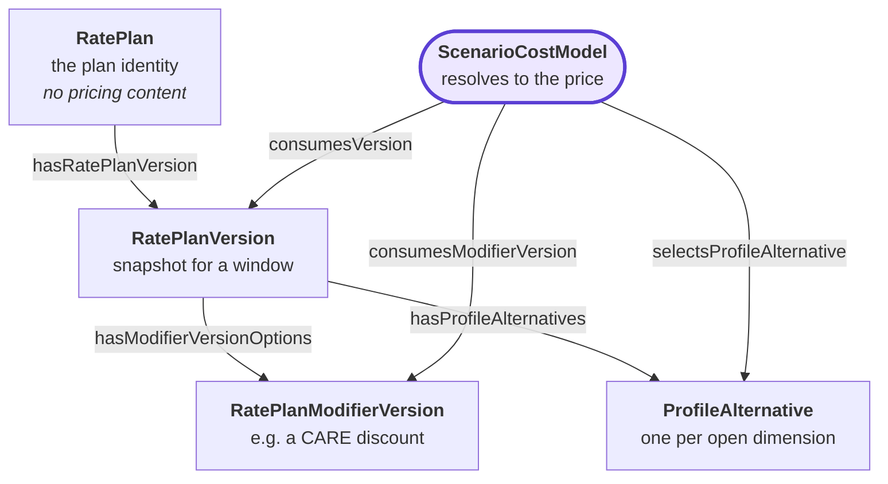
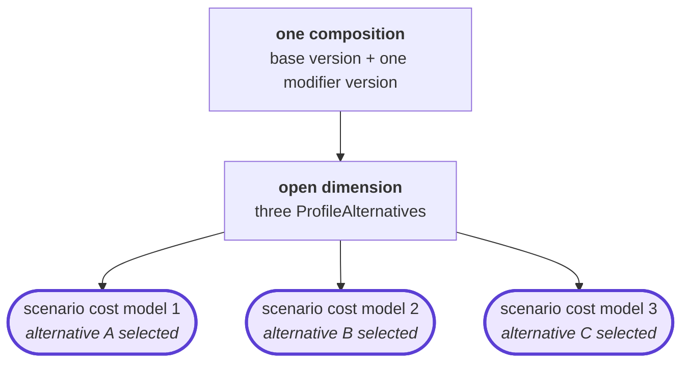

<!-- SPDX-FileCopyrightText: 2026 Clark Communications Corporation -->
<!-- SPDX-License-Identifier: CDLA-Permissive-2.0 -->

# Scenario cost models

**A scenario cost model is URPX's `urpx:ScenarioCostModel`: what a particular customer actually takes service under, as one fully determined selection over the plan space.** It binds the `urpx:RatePlanVersion` it prices (`urpx:consumesVersion`), the `urpx:RatePlanModifierVersion`s applied to it (`urpx:consumesModifierVersion`), and one `urpx:ProfileAlternative` per alternative dimension they leave open (`urpx:selectsProfileAlternative`). It is the unit an OpenADR 3 price server publishes as a program for an energy-management system to subscribe to.

`urpx:consumesModifierVersion` and `urpx:selectsProfileAlternative`, the `sh:maxCount 1` on `urpx:consumesVersion`, and `urpx:name` and `urpx:description` on `ScenarioCostModelShape` are proposed in [urpx-org/urpx#72](https://github.com/urpx-org/urpx/pull/72) and are not yet in a URPX release. This repository validates against that pull request's head, cd13ce8a.

This document says "scenario cost model" in full and never "scenario" alone, because `urpx:Scenario` is a different class: a container of customer and service-point profiles against which eligibility rules are evaluated, which a scenario cost model may name through `urpx:forScenario`.

## What it is

> one `urpx:RatePlanVersion`, plus every `urpx:RatePlanModifierVersion` that applies to it and that the customer has, plus one `urpx:ProfileAlternative` for each dimension any of them leaves open.



*Fully determined* means one free variable remains, the instant. A scenario cost model binds every other input to price resolution; give it an instant it covers and it returns the price. If a choice is still outstanding it is not one scenario cost model but several, and each of those is a scenario cost model in its own right.

A rate plan is what a utility publishes; a scenario cost model is what a particular customer is actually billed under, and a plan generally admits many.

## What determines one

Three questions, each answered by URPX constructs.

**Which base version.** `urpx:RatePlanVersionShape` requires exactly one `urpx:forRatePlan` (`min 1 max 1`), so every version names the plan identity it is a snapshot of. That link, not the filing's directory path, is what groups versions into a plan.

**Which modifier versions.** `urpx:RatePlanModifierVersionShape` carries `urpx:applicableToRatePlan` and `urpx:applicableToRatePlanVersion`, both `min 0 max None`. The first states compatibility with a plan identity, the second with a specific version. Both are statements of what *may* combine. Which of the compatible modifiers a given customer actually has is a fact about the customer, and URPX deliberately places customer data outside its scope: `urpx:AccountServiceAgreement` carries the `skos:note` "Service account and agreement data lives in customer data, not URPX."

So a customer's scenario cost model is not derivable from a customer record the corpus does not hold. What the corpus can enumerate is the scenario cost models its documents *express*: every combination the filings say is permitted. That set is what a price server can publish, and it is larger than any one customer's.

**Which alternative per open dimension.** `urpx:PlanElementsShape.hasProfileAlternatives` is `min 0 max 1`, so a version reaches at most one container, but `urpx:AlternativeDimensionsShape.hasAlternativeDimension` is `min 1 max None`, so one container holds several dimensions and the `urpx:ProfileAlternative` members are the cells of their cross product. A `urpx:PriceDefinition` may reference several alternatives (`referencesProfileAlternative`, `min 0 max None`) while a `urpx:PriceSetAlternative` references exactly one (`min 1 max 1`). A selection is therefore one member per container.

## Compositions

A **composition** is a base version plus a modifier set, with open dimensions not yet selected. It stands for one scenario cost model per selection: a base plus a modifier over a three-value dimension is one composition and three scenario cost models. The reports measure servability per composition, because that is the grain `dev/baseline/marginal-rates.edn` records.



Which modifier sets may sit on one base is a policy, because nothing in URPX states that two modifiers exclude or combine. This corpus enumerates the base alone and the base plus exactly one modifier (`COMBINE_AT_MOST_ONE_MODIFIER` in `dev/scenario_cost_models.py`); clj-urpx's `urpx.scenario-cost-model` calls the same policy `one-modifier-at-most`.

## What makes two distinct

Their components. A scenario cost model is identified **intrinsically**, by the tuple:

```
(base version IRI, sorted modifier version IRIs, sorted alternative IRIs)
```

That is computable from the documents alone, stable across regeneration, and requires nothing external. Two scenario cost models are the same when that tuple matches, and different otherwise, including when they resolve to the same price: a bundled customer and a customer buying generation elsewhere may be charged the same delivery rate and are on different scenario cost models.

An alternative IRI names its container, so the selection is recorded as the alternatives alone. An alternative offered by two containers would make that ambiguous, and the enumeration refuses it.

## IRIs

A scenario cost model's IRI is derived from its identity tuple alone, so a second implementation produces the same IRI for the same node. `model_iri` in `dev/scenario_cost_models.py` implements this; `dev/test_scenario_cost_models.py` checks it against the vectors below.

**Input.** The tuple, with every IRI absolute: compact IRIs are expanded through the filing's `@context` (`pge:e-1-2026-03-01` becomes `https://rate-plans.grid-coordination.energy/pge/e-1-2026-03-01`). Modifier IRIs and alternative IRIs are each sorted ascending by code point. Every IRI is ASCII, so code-point order and UTF-16 order agree.

**Namespace.** The base version IRI must start with `https://rate-plans.grid-coordination.energy/`; the next path segment is the utility, and the namespace `N` is `https://rate-plans.grid-coordination.energy/<utility>/`. Every modifier and alternative IRI must also start with `N`. The *local name* of an IRI is what follows `N`. Every local name must match `^[a-z0-9]+(-[a-z0-9]+)*$`: lower-case ASCII letters and digits in words joined by single hyphens, so `--` cannot occur inside one. A component that breaks either rule is refused, never escaped.

**Slug.** `scm-`, then the base version's local name, then for each modifier in sorted order `--` and its local name. When the tuple has at least one alternative, append `--` and the hash. When it has none, append nothing: the slug is then unique on its own.

**Hash.** SHA-256 over the UTF-8 bytes of these lines, joined by a single line feed (U+000A), with no trailing line feed:

```
base <base version IRI>
modifier <modifier version IRI>          one line per modifier, sorted
alternative <alternative IRI>            one line per alternative, sorted
```

The hash is the first 12 characters of the lower-case hexadecimal digest. It covers the whole tuple, not only the alternatives.

**IRI.** `N` followed by the slug. The JSON-LD writes it compactly under the utility's prefix.

**Degenerate cases.** An absent property is how RDF says there is no value, so `urpx:consumesModifierVersion` and `urpx:selectsProfileAlternative` are omitted when empty, never written as empty lists. `urpx:consumesVersion` is always present.

| Case | `consumesModifierVersion` | `selectsProfileAlternative` | IRI |
|---|---|---|---|
| base alone, nothing open | omitted | omitted | `N` + `scm-<base>` |
| modifiers, nothing open | present | omitted | `N` + `scm-<base>--<modifier>...` |
| no modifier, alternatives | omitted | present | `N` + `scm-<base>--<hash>` |
| modifiers and alternatives | present | present | `N` + `scm-<base>--<modifier>...--<hash>` |

**Vectors.** With `N` = `https://rate-plans.grid-coordination.energy/pge/`:

| Base | Modifiers | Alternatives | IRI |
|---|---|---|---|
| `N`+`e-1-2026-03-01` | none | none | `N`+`scm-e-1-2026-03-01` |
| `N`+`e-1-2026-03-01` | `N`+`e-1-vintage-pcia-2026-03-01` | none | `N`+`scm-e-1-2026-03-01--e-1-vintage-pcia-2026-03-01` |
| `N`+`e-elec-2026-03-27` | none | `N`+`e-elec-2026-03-27-pa-income-tier-care` | `N`+`scm-e-elec-2026-03-27--291186d914f7` |
| `N`+`e-1-2026-03-01` | `N`+`e-1-vintage-pcia-2026-03-01` | `N`+`e-1-2026-03-01-pa-tc-w-b`, `N`+`e-1-vintage-pcia-2026-03-01-pa-vintage-2020` | `N`+`scm-e-1-2026-03-01--e-1-vintage-pcia-2026-03-01--deed42bdeaaa` |

The first two vectors exercise the rules; neither is in the corpus, because PG&E E-1 leaves its baseline territory open. The last two are nodes in `reports/scenario-cost-models.jsonld`.

## The emitted document

`dev/list_scenario_cost_models.py` writes `reports/scenario-cost-models.jsonld`: one `urpx:ScenarioCostModel` node per current scenario cost model the corpus expresses under the policy above, every one referencing the corpus's own version and alternative `@id`s. It is one file for the corpus, like every other report, and it is never written into a filing. [`reports/scenario-cost-models.md`](../reports/scenario-cost-models.md) gives the count.

```json
{
  "@id": "cpau:scm-e-1-2025-07-01",
  "@type": "urpx:ScenarioCostModel",
  "urpx:name": "Residential Electric Service [cpau:e-1-2025-07-01]",
  "urpx:consumesVersion": { "@id": "cpau:e-1-2025-07-01" }
}
```

It is a bare `@graph`, not a `urpx:URPXPackage`. #72 lets `urpx:packages` carry a `urpx:ScenarioCostModel`, but a package must state a `urpx:targetURPXVersion`, and v0.5.1, the release the corpus targets, admits none of the properties these nodes use. The document becomes a `urpx:URPXPackage` when #72 ships in a release.

Each node's `urpx:name` is built from the consumed plans' and selected alternatives' own `urpx:name`s, with each consumed version's `@id` in brackets. It is a label, not an identifier: the IRI is. `reports/scenario-cost-models.edn` maps each IRI to the same name and to its composition's servability.

`dev/gate.sh` validates the document merged with the whole corpus against the URPX shapes and ontology at cd13ce8a, and the clj-urpx cross-check below compares its nodes with both enumerations.

## Computing the set

A client that needs the scenario cost models, such as a price server publishing one program per model, should compute them from the corpus rather than read `reports/scenario-cost-models.jsonld`. The committed document is current as of its last regeneration, and a version that takes effect afterwards changes the set with no change to the corpus.

clj-urpx computes it. Walk the corpus's documents (`corpus.json` lists them and the walkers that read them), load them with `urpx.load/documents` as `dev/cross_check_scenario_cost_models.clj` does, and call `urpx.scenario-cost-model/enumerate` with every policy pinned to the ones this corpus is checked under:

| Option | Value |
|---|---|
| `:at` | the instant the set is wanted for |
| `:combine` | `one-modifier-at-most` |
| `:compatibility` | `named-versions-add`, which is not clj-urpx's default; see [Agreement with clj-urpx](#agreement-with-clj-urpx) |
| `:repeated-ids` | `repeated-ids-refuse` |
| `:package-zones` | `:agree` |

The IRIs follow [IRIs](#iris), which clj-urpx implements as `urpx.scenario-cost-model/rate-plans-iri` and tests against the vectors there; `urpx.scenario-cost-model/node` with it as the IRI function builds each model's node. Each node's `urpx:name` is this corpus's label, built as [The emitted document](#the-emitted-document) describes; a client wanting the same names builds them the same way.

The committed document is the reference such a client is checked against: `dev/gate.sh` requires clj-urpx's enumeration, at the pinned instant and under these policies, to equal it node for node.

## What makes one current

A scenario cost model is current when every component of it is current.

A version is current when no later version of the same plan identity has taken effect. Supersession is derived from `urpx:forRatePlan` / `urpx:forRatePlanModifier` together with `urpx:effectiveDateTime`, never from a filing's directory name: a directory count is not a version count. A modifier version inlined into the filings that use it is one node written down in several places: `pge:e-tou-c-vintage-pcia-2026-03-01` sits in two directories of the same plan.

`urpx:expirationDateTime` is admitted on both version shapes (`min 0 max 1`) and states when a version stopped being in force. It is the only end bound available to a publisher that files versions directly: `urpx:supersedes`, `urpx:replaces`, `urpx:replacedBy` and `urpx:cancelledBy` all carry domains of `urpx:PricingModel` or `urpx:TariffFiling` only, and are not admitted on either closed version shape. So such a publisher can say a version *ended* and cannot say *what ended it*; succession has to be inferred from the intervals touching.

A superseded version takes part in no scenario cost model. Nobody takes service under it, and it should not appear in any set offered for use.

## Identifiers

A scenario cost model is identified by its own components, as above. Some jurisdictions additionally publish an identifier for some of them, and where one exists and can be confidently matched it is worth recording as an attestation, with how the correspondence was established. It is never the identity: a scenario cost model exists whether or not anything names it, a jurisdiction may publish no scheme at all, and matching a published identifier to the documents that produce its prices is straightforward in some cases and intractable in others. `ScenarioCostModelShape` does not admit `urpx:hasIdentifier`, so none is attached to the nodes.

California's MIDAS is one such scheme. [midas-rins-and-scenario-cost-models.md](./midas-rins-and-scenario-cost-models.md) covers it, including why such an identifier cannot be recorded as a plan or modifier identifier.

## What this corpus does with it

[`reports/scenario-cost-models.{md,edn,jsonld}`](../reports/) enumerates the scenario cost models the filings express, reports for each composition whether a price server asking for a price gets a number back, and carries the nodes. [`reports/ready-for-use.md`](../reports/ready-for-use.md) rolls servability up per filing.

All three are generated from the corpus and the recorded resolution baseline. None writes anything into a filing, and none reads or assigns an identifier.

## Agreement with clj-urpx

clj-urpx's `urpx.scenario-cost-model` enumerates the same set independently. `dev/cross_check_scenario_cost_models.py` compares, at a pinned instant and under named policies, in both directions: the (base version, modifier versions) compositions against `urpx.scenario-cost-model/enumerate-pairs`; the scenario cost models with open dimensions expanded against `urpx.scenario-cost-model/enumerate`, read through `identity-tuple`; the nodes of `reports/scenario-cost-models.jsonld` against that expanded set, re-deriving every node's IRI on the way; and those nodes against the ones `urpx.scenario-cost-model/node` builds under `rate-plans-iri`, comparing `@id`, `@type` and references. It runs in `dev/gate.sh`, which prints the agreed counts on every run. If `urpx.scenario-cost-model` does not load, or lacks a var the check calls, the check fails and names what is missing, including whether `urpx.arrangements`, its name through clj-urpx 0.35.0, loads in its place; `dev/test_cross_check_namespaces.py` makes each of those cases fire.

One thing that agreement does not settle. Whether stating `urpx:applicableToRatePlanVersion` narrows the compatibility `urpx:applicableToRatePlan` asserts, or adds to it, is open. clj-urpx ships both readings and takes no position between them; this repository assumes the additive one. Worth knowing for anyone reading this corpus with it: its default is the third reading below, the one nothing in the decision argues for.

The decision that introduced the property, URPX Decision #090, is the only artifact evidence found so far, and **it supports both readings a few lines apart**. For additive, its selected alternative "Preserves the existing document-level properties for document-scoped relationships", and its impact is recorded as "Breaking Change: None - this is an additive enhancement". For narrowing, its rationale says the new properties "avoid ambiguity where a modifier document is broadly applicable but only certain modifier versions are valid for a particular rate plan version", which is narrowing described.

Each reading has an honest cost. Under the additive one the property can never change an answer that `applicableToRatePlan` did not already license, so a decision taken to add precision buys almost none. Under the narrowing one, merging a document can retract a compatibility that held before it, which RDF merge never does.

There are three readings rather than two, and the rationale sentence above is about the third. It restricts which *modifier* versions pair with a given base version, which is the mirror property `urpx:hasModifierVersionOptions` doing its job, and says nothing about whether naming a version of one plan withdraws a modifier from the other plans it names. So: add, retracting nothing; narrow within a plan whose version is named, leaving unnamed plans whole; or fully exhaustive, retracting everything unnamed. Nothing in the decision argues for the third.

This corpus distinguishes none of them. The one node that separated the first from the third was a copy-local artifact and was removed; the first and second differ only when a modifier names version(s) of a plan without naming that plan's current version, which occurs zero times here. So a passing cross-check is not evidence for the reading this repository pins, and the discriminating fixtures live in the test suite because no filing can carry them. The working group should say which the decision meant.
