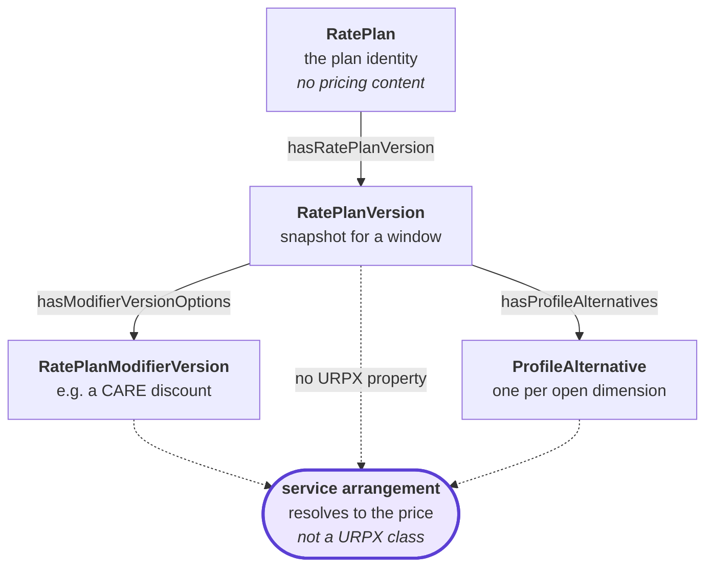
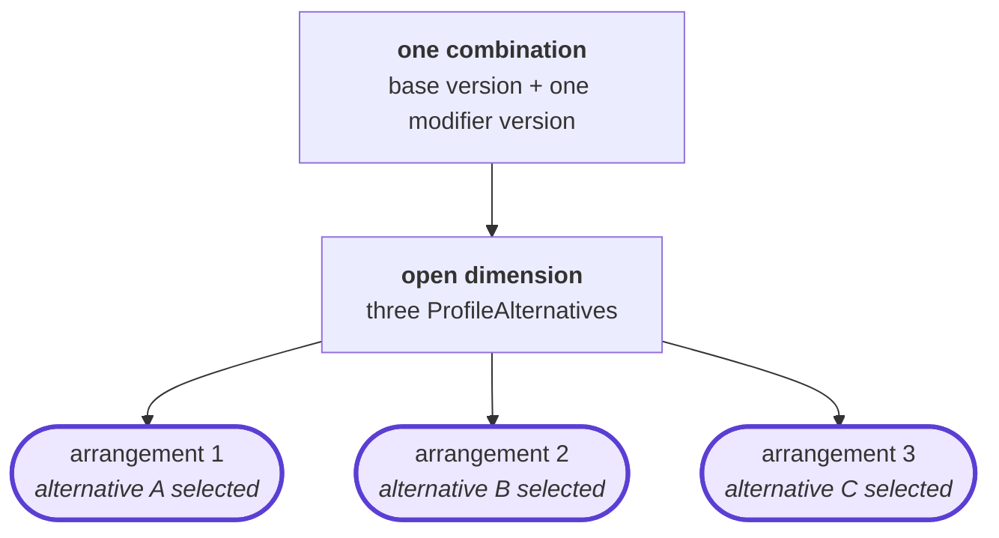

<!-- SPDX-FileCopyrightText: 2026 Clark Communications Corporation -->
<!-- SPDX-License-Identifier: CDLA-Permissive-2.0 -->

# Service arrangements

**`ServiceArrangement` is not a URPX class.** It occurs zero times in the URPX ontology and zero times in the SHACL shapes. It is this corpus's term for a thing the standard describes the parts of and does not name the whole of. Nothing in this repository writes it into a filing, and it carries no `urpx:` prefix anywhere, deliberately.

## What it is

A **service arrangement** is a fully determined selection over the plan space:

> one `urpx:RatePlanVersion`, plus every `urpx:RatePlanModifierVersion` that applies to it and that the customer has, plus one `urpx:ProfileAlternative` for each dimension any of them leaves open.



The dotted edges are the point. URPX names every relationship above except the ones that assemble the result, which is why this document exists.

*Fully determined* means one free variable remains, the instant. An arrangement binds every other input to price resolution; give it an instant it covers and it returns the price. If a choice is still outstanding it is not one arrangement but several, and each of those is an arrangement in its own right.

It is the thing a customer takes service under. A rate plan is what a utility publishes; an arrangement is what a particular customer is actually billed under, and a plan generally admits many.

## What determines one

Three questions, each answered by URPX constructs.

**Which base version.** `urpx:RatePlanVersionShape` requires exactly one `urpx:forRatePlan` (`min 1 max 1`), so every version names the plan identity it is a snapshot of. That link, not the filing's directory path, is what groups versions into a plan.

**Which modifier versions.** `urpx:RatePlanModifierVersionShape` carries `urpx:applicableToRatePlan` and `urpx:applicableToRatePlanVersion`, both `min 0 max None`. The first states compatibility with a plan identity, the second with a specific version. Both are statements of what *may* combine. Which of the compatible modifiers a given customer actually has is a fact about the customer, and URPX deliberately places customer data outside its scope: `urpx:AccountServiceAgreement` carries the `skos:note` "Service account and agreement data lives in customer data, not URPX."

So an arrangement is not derivable from a customer record the corpus does not hold. What the corpus can enumerate is the arrangements its documents *express*: every combination the filings say is permitted. That set is what a price server can publish, and it is larger than any one customer's.

**Which alternative per open dimension.** `urpx:PlanElementsShape.hasProfileAlternatives` is `min 0 max 1`, so a version reaches at most one container, but `urpx:AlternativeDimensionsShape.hasAlternativeDimension` is `min 1 max None`, so one container holds several dimensions and the `urpx:ProfileAlternative` members are the cells of their cross product. A `urpx:PriceDefinition` may reference several alternatives (`referencesProfileAlternative`, `min 0 max None`) while a `urpx:PriceSetAlternative` references exactly one (`min 1 max 1`).

An open dimension is what turns one enumerated combination into several arrangements. A base plus a modifier over a three-value dimension is three arrangements, not one.



## What makes two arrangements distinct

Their components. An arrangement is identified **intrinsically**, by the tuple:

```
(base version IRI, sorted modifier version IRIs, sorted alternative selections)
```

That is computable from the documents alone, stable across regeneration, and requires nothing external. Two arrangements are the same arrangement when that tuple matches, and different otherwise — including when they resolve to the same price. Equal prices do not make one arrangement: a bundled customer and a customer buying generation elsewhere may be charged the same delivery rate and are still on different arrangements.

## What makes one current

An arrangement is current when every component of it is current.

A version is current when no later version of the same plan identity has taken effect. Supersession is derived from `urpx:forRatePlan` / `urpx:forRatePlanModifier` together with `urpx:effectiveDateTime`, never from a filing's directory name: a directory count is not a version count, and this corpus contains two directories holding one version node.

`urpx:expirationDateTime` is admitted on both version shapes (`min 0 max 1`) and states when a version stopped being in force. It is the only end bound available to a publisher that files versions directly: `urpx:supersedes`, `urpx:replaces`, `urpx:replacedBy` and `urpx:cancelledBy` all carry domains of `urpx:PricingModel` or `urpx:TariffFiling` only, and are not admitted on either closed version shape. So such a publisher can say a version *ended* and cannot say *what ended it*; succession has to be inferred from the intervals touching.

A superseded version is not a service arrangement. Nobody takes service under it, and it should not appear in any set of arrangements offered for use.

## Identifiers

An arrangement is identified by its own components, as above. Some jurisdictions additionally publish an identifier for some arrangements, and where one exists and can be confidently matched it is worth recording as an attestation, with how the correspondence was established. It is never the arrangement's identity: an arrangement exists whether or not anything names it, a jurisdiction may publish no scheme at all, and matching a published identifier to the documents that produce its prices is straightforward in some cases and intractable in others.

California's MIDAS is one such scheme. [midas-rins-and-service-arrangements.md](./midas-rins-and-service-arrangements.md) covers it, including why such an identifier cannot be recorded as a plan or modifier identifier.

## What this corpus does with it

[`reports/service-arrangements.{md,edn}`](../reports/) enumerates the arrangements the filings express and reports, for each, whether a price server asking for a price gets a number back. [`reports/ready-for-use.md`](../reports/ready-for-use.md) rolls that up per filing.

Both are generated from the corpus and the recorded resolution baseline. Neither writes anything into a filing, and neither reads or assigns an identifier.

## Open question

Whether arrangement enumeration belongs in a general URPX reader or stays corpus-side is unsettled. The three rules it needs — supersession from `forRatePlan` and `effectiveDateTime`, compatibility of a modifier version with a base version, and the open `ProfileAlternatives` dimensions — are URPX constructs with no jurisdiction in them, which argues for the former. Two implementations of one rule in different languages need a cross-check asserting they agree, which argues for deciding rather than drifting.

The second implementation exists: `urpx.arrangements`, in the pinned clj-urpx 0.30.0. `dev/cross_check_arrangements.py` compares the set of (base version, modifier versions) pairs the two enumerate, in both directions, at a pinned instant and under named policies, and runs in `dev/gate.sh`. The two agree on 144.

One thing that agreement does not settle. Whether stating `urpx:applicableToRatePlanVersion` narrows the compatibility `urpx:applicableToRatePlan` asserts, or adds to it, is open. clj-urpx ships both readings and takes no position; this repository assumes the additive one.

The decision that introduced the property, URPX Decision #090, is the only artifact evidence found so far, and **it supports both readings a few lines apart**. For additive, its selected alternative "Preserves the existing document-level properties for document-scoped relationships", and its impact is recorded as "Breaking Change: None - this is an additive enhancement". For narrowing, its rationale says the new properties "avoid ambiguity where a modifier document is broadly applicable but only certain modifier versions are valid for a particular rate plan version", which is narrowing described.

Each reading has an honest cost. Under the additive one the property can never change an answer that `applicableToRatePlan` did not already license, so a decision taken to add precision buys almost none. Under the narrowing one, merging a document can retract a compatibility that held before it, which RDF merge never does.

There are three readings rather than two, and the rationale sentence above is about the third. It restricts which *modifier* versions pair with a given base version, which is the mirror property `urpx:hasModifierVersionOptions` doing its job, and says nothing about whether naming a version of one plan withdraws a modifier from the other plans it names. So: add, retracting nothing; narrow within a plan whose version is named, leaving unnamed plans whole; or fully exhaustive, retracting everything unnamed. Nothing in the decision argues for the third.

This corpus distinguishes none of them. The one node that separated the first from the third was a copy-local artifact and was removed; the first and second differ only when a modifier names version(s) of a plan without naming that plan's current version, which occurs zero times here. So a passing cross-check is not evidence for the reading this repository pins, and the discriminating fixtures live in the test suite because no filing can carry them. The working group should say which the decision meant.
